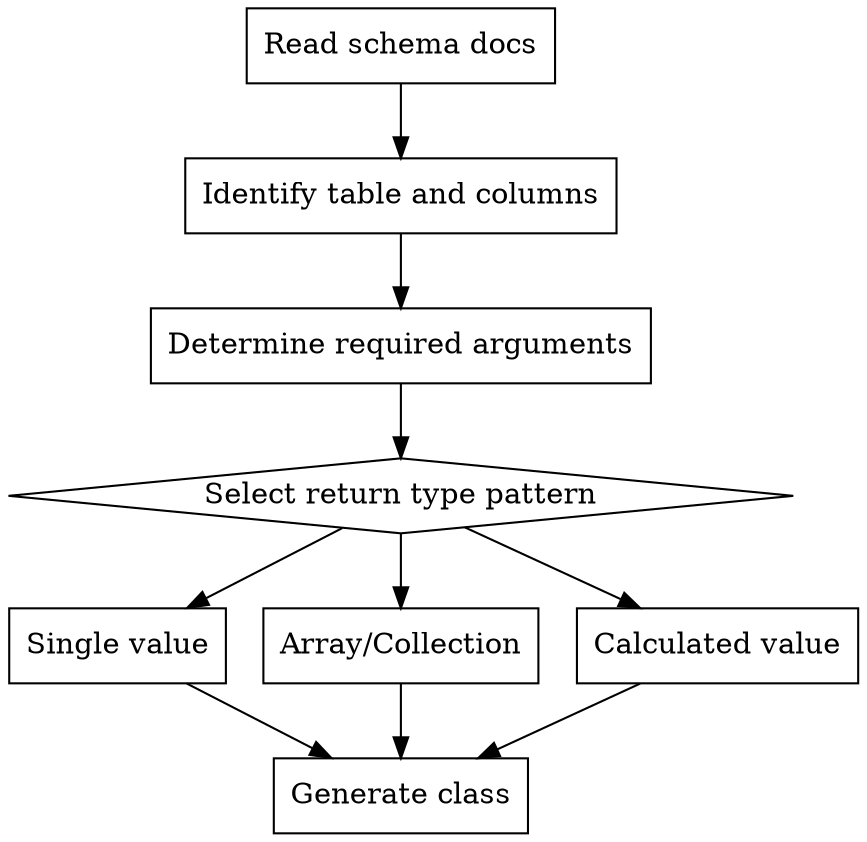

# ClickHouse Query Class Generator

Generate complete `ClickhouseQuery` class files from raw ClickHouse SQL.

## Instructions

1. **Read schema documentation** - Check `database/clickhouse/ai-docs/` for table-specific docs
2. **Parse the ClickHouse SQL** - Identify tables, columns, aggregations, and ClickHouse-specific functions
3. **Determine required arguments** - Analyze the SQL to identify filter columns needed
4. **Determine the class name and namespace** - Based on query purpose and domain
5. **Apply project patterns** - Use established conventions from `app/Queries/`

## Schema Documentation Reference

**Before generating a query class, read the relevant schema documentation:**

1. **Read the index:** `database/clickhouse/ai-docs/README.md` - Lists all tables and their doc files
2. **Read the table doc:** Based on the table in your SQL, read the specific doc file to understand:
   - Available columns and their types
   - Filter columns (org_id, branch_id, client_org_id, etc.)
   - Aggregation patterns (which columns use `SUM`, which use `uniqMerge`, etc.)
   - Query examples to follow as patterns

If the docs don't exist yet, analyze existing query classes in `app/Queries/` that use the same table.

## Decision Tree



## Class Template

```php
<?php

namespace App\Queries\{Subdirectory};

use App\Queries\ClickhouseQuery;
use Carbon\Carbon;
use Illuminate\Support\Facades\DB;

class {ClassName} extends ClickhouseQuery
{
    public static function handle(array $arguments = []): mixed
    {
        return DB::clickhouse('table_name', final: true)
            ->where('org_id', $arguments['org_id'])
            ->where('hour_timestamp', '>=', Carbon::parse($arguments['start'], $arguments['timezone'] ?? 'UTC')->utc()->toDateTimeString())
            ->where('hour_timestamp', '<=', Carbon::parse($arguments['end'], $arguments['timezone'] ?? 'UTC')->utc()->toDateTimeString())
            ->when($arguments['branch_id'] ?? false, fn ($query) => $query->where('branch_id', $arguments['branch_id']))
            ->when($arguments['client_org_id'] ?? false, fn ($query) => $query->where('client_org_id', $arguments['client_org_id']))
            ->selectRaw('...')
            ->value('column');
    }
}
```

## DB::clickhouse() Macro Parameters

```php
DB::clickhouse(
    table: 'table_name',      // Required: table name without schema
    connection: 'clarity',     // 'clarity' (default) or 'zod'
    final: true,              // Add FINAL keyword for ClickHouse
    as: 'alias'               // Optional table alias
)
```

## Dynamic Argument Patterns

**Arguments should be determined by the specific query's needs.** Analyze the SQL to identify:

1. **Required filters** - Columns in WHERE clauses that need dynamic values
2. **Optional filters** - Columns that may or may not be filtered (use `->when()`)
3. **Date range handling** - If filtering by timestamps, include `start`, `end`, `timezone`

### Common Argument Patterns

| Argument Type | When to Include | Pattern |
|---------------|-----------------|---------|
| `org_id` | Always for tenant-filtered tables | `->where('org_id', $arguments['org_id'])` |
| `start`/`end` | When filtering by timestamp | `Carbon::parse($arguments['start'], $arguments['timezone'] ?? 'UTC')->utc()` |
| `timezone` | When using date range | `$arguments['timezone'] ?? 'UTC'` |
| `branch_id` | When optional branch filtering | `->when($arguments['branch_id'] ?? false, fn ($q) => $q->where(...))` |
| `client_org_id` | When optional client filtering | `->when($arguments['client_org_id'] ?? false, fn ($q) => $q->where(...))` |
| Custom filters | Based on SQL WHERE clauses | Analyze the SQL and add as needed |

### Example: Query-Specific Arguments

```php
// TotalAssignments uses new_status and old_status filters
->where('new_status', HotlistStatus::Open->value)
->whereIntegerInRaw('old_status', [HotlistStatus::Other->value, 90])

// MonthlySparklineData uses months instead of start/end
$months = $arguments['months'] ?? 12;
->where('hour_timestamp', '>=', now()->subMonths($months)->startOfMonth())
```

## ClickHouse-Specific Functions

Use ClickHouse native functions directly:

| Function | Purpose | Example |
|----------|---------|---------|
| `toDate(col)` | Convert to date | `toDate(hour_timestamp)` |
| `toStartOfMonth(col)` | Month grouping | `toDate(toStartOfMonth(hour_timestamp)) as month` |
| `toStartOfDay(col)` | Day grouping | `toDate(toStartOfDay(hour_timestamp)) as day` |
| `toStartOfWeek(col)` | Week grouping | `toDate(toStartOfWeek(hour_timestamp)) as week` |
| `uniqMerge(col)` | Merge unique count states | `uniqMerge(unique_hotlists) AS total` |
| `sumMerge(col)` | Merge sum states | `sumMerge(total_value) AS total` |
| `countMerge(col)` | Merge count states | `countMerge(record_count) AS total` |
| `avgMerge(col)` | Merge average states | `avgMerge(avg_value) AS average` |
| `dateDiff(unit, start, end)` | Date difference | `dateDiff('day', created_at, closed_at)` |

## Return Type Patterns

### Single Integer Value
```php
return (int) DB::clickhouse('table')
    ->selectRaw('SUM(column) as total')
    ->value('total');
```

### Array with Key-Value Pairs
```php
return DB::clickhouse('table', final: true)
    ->selectRaw('toDate(toStartOfMonth(hour_timestamp)) as month, SUM(column) as total')
    ->groupBy('month')
    ->orderBy('month')
    ->pluck('total', 'month')
    ->toArray();
```

### Calculated Value with Post-Processing
```php
$result = DB::clickhouse('table')
    ->selectRaw('SUM(numerator) as total_numerator, SUM(denominator) as total_denominator')
    ->first();

if (\gettype($result) === 'object') {
    $result = (array) $result;
}

if (! $result || $result['total_denominator'] == 0) {
    return 0;
}

$average = $result['total_numerator'] / $result['total_denominator'];

if ($average > 0 && $average < 1) {
    return '< 1';
}

return round($average, 1);
```

### Collection Result
```php
return DB::clickhouse('table')
    ->select(['col1', 'col2', 'col3'])
    ->where(...)
    ->get()
    ->map(fn ($row) => [
        'key' => $row->col1,
        'value' => (int) $row->col2,
    ])
    ->toArray();
```

## Namespace and File Location

| Domain | Namespace | File Path |
|--------|-----------|-----------|
| Client analytics | `App\Queries\Client` | `app/Queries/Client/{ClassName}.php` |
| Dashboard metrics | `App\Queries\Dashboard` | `app/Queries/Dashboard/{ClassName}.php` |
| Scan operations | `App\Queries\Scans` | `app/Queries/Scans/{ClassName}.php` |

## Example Transformation

### Input SQL
```sql
SELECT
    toDate(toStartOfMonth(hour_timestamp)) as month,
    SUM(total_assignments) as total
FROM client_stats_aggregate FINAL
WHERE org_id = 123
  AND hour_timestamp >= '2024-01-01'
  AND hour_timestamp <= '2024-12-31'
GROUP BY month
ORDER BY month
```

### Output Class
```php
<?php

namespace App\Queries\Client;

use App\Queries\ClickhouseQuery;
use Carbon\Carbon;
use Illuminate\Support\Facades\DB;

class MonthlyAssignments extends ClickhouseQuery
{
    public static function handle(array $arguments = []): array
    {
        return DB::clickhouse('client_stats_aggregate', final: true)
            ->selectRaw('toDate(toStartOfMonth(hour_timestamp)) as month, SUM(total_assignments) as total')
            ->where('org_id', $arguments['org_id'])
            ->where('hour_timestamp', '>=', Carbon::parse($arguments['start'], $arguments['timezone'] ?? 'UTC')->utc()->toDateTimeString())
            ->where('hour_timestamp', '<=', Carbon::parse($arguments['end'], $arguments['timezone'] ?? 'UTC')->utc()->toDateTimeString())
            ->when($arguments['branch_id'] ?? false, fn ($q) => $q->where('branch_id', $arguments['branch_id']))
            ->when($arguments['client_org_id'] ?? false, fn ($q) => $q->where('client_org_id', $arguments['client_org_id']))
            ->groupBy('month')
            ->orderBy('month')
            ->pluck('total', 'month')
            ->toArray();
    }
}
```

**Required arguments:** `org_id`, `start`, `end`
**Optional arguments:** `timezone` (defaults to UTC), `branch_id`, `client_org_id`

## Output Format

Return the complete class file in a code block with the suggested file path:

```
File: app/Queries/{Subdirectory}/{ClassName}.php
```

```php
<?php
// Full class implementation here
```

**Notes to include:**
- Required arguments for the query (determined from SQL analysis)
- Optional arguments with their defaults
- Return type explanation
- Any assumptions made about the data structure

## ClickHouse SQL to Convert

$ARGUMENTS
