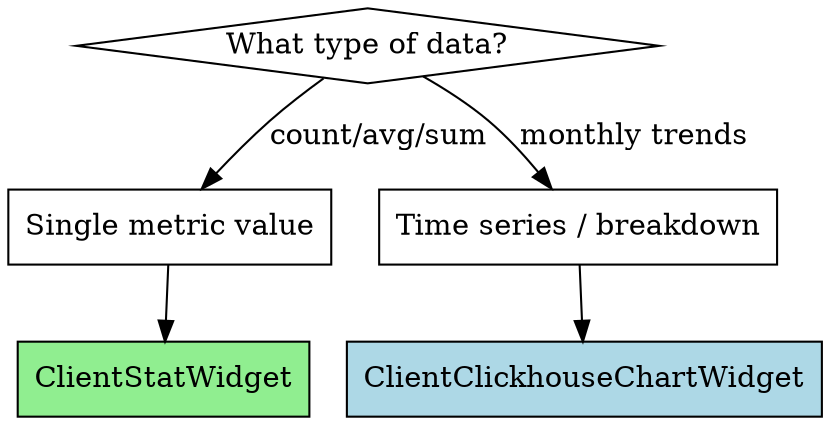

# ClickHouse Widget Builder

Create ClickHouse-powered Filament widgets following project patterns.

## Checklist

**Use TodoWrite to create a todo for EACH item:**

- [ ] Choose base class: `ClientStatWidget` (stat card) or `ClientClickhouseChartWidget` (chart)
- [ ] Define `getLabel()` method (stat) or set `$heading` property (chart)
- [ ] Implement `getModelQueryForDates()` or `getDatasetConfigs()`
- [ ] Use proper scope chaining: `->forOrg()`, `->between()`, `->forBranch()`, `->forClient()`
- [ ] Add batch caching support via `getBatchCacheKey()` if applicable
- [ ] Implement `getTooltipDescription()` for stat cards
- [ ] Register widget in appropriate dashboard page
- [ ] Ensure `#[On('refresh-dashboard')]` event is inherited (automatic from base class)

## Widget Type Selection



## Stat Widget (ClientStatWidget)

For single-value metrics with period-over-period comparison:

```php
<?php

namespace App\Filament\Widgets\Client;

use App\Filament\Widgets\Client\Concerns\ClientStatWidget;
use App\Models\Clickhouse\{AggregateModel};

class {WidgetName}Widget extends ClientStatWidget
{
    protected function getLabel(): string
    {
        return 'Widget Label';
    }

    // Enable batch caching (optional but recommended)
    protected function getBatchCacheKey(): ?string
    {
        return 'metric-key'; // e.g., 'assignments', 'recoveries'
    }

    protected function getModelQueryForDates(string $startDate, string $endDate): int
    {
        return (int) {AggregateModel}::query()
            ->final()
            ->forOrg($this->org_id)
            ->between($startDate, $endDate)
            ->forBranch($this->branch_id)
            ->forClient($this->client_org_id)
            // Add specific scopes for the metric
            ->openAssignments() // or other status scope
            ->selectRaw('uniqMerge(unique_hotlists) AS total')
            ->value('total') ?? 0;
    }

    protected function getTooltipDescription(): ?string
    {
        return 'Explains what this metric measures.';
    }

    // Override if lower values are better (e.g., days to repo)
    protected function isLowerBetter(): bool
    {
        return false; // default, higher is better
    }
}
```

## Chart Widget (ClientClickhouseChartWidget)

For time-series or breakdown charts:

```php
<?php

namespace App\Filament\Widgets\Client;

use App\Filament\Widgets\Client\Concerns\ClientClickhouseChartWidget;
use App\Models\Clickhouse\{AggregateModel};

class {WidgetName}Chart extends ClientClickhouseChartWidget
{
    protected ?string $heading = 'Chart Title';
    protected ?string $description = 'Chart description.';

    protected function getDatasetConfigs(): array
    {
        return [
            [
                'label' => 'Dataset Name',
                'color' => 'rgba(34, 197, 94, 0.7)', // Green
                'query' => fn () => {AggregateModel}::query()
                    ->final()
                    ->forOrg($this->org_id ?? auth()->user()->org_id)
                    ->between($this->getStartDate(), $this->getEndDate())
                    ->forBranch($this->branch_id)
                    ->forClient($this->client_org_id)
                    ->specificScope()
                    ->byMonth()
                    ->pluck('total', 'month'),
            ],
            // Add more datasets as needed
        ];
    }
}
```

## Common ClickHouse Model Scopes

| Scope | Purpose |
|-------|---------|
| `->final()` | Add FINAL keyword for ReplacingMergeTree |
| `->forOrg($orgId)` | Filter by organization |
| `->between($start, $end)` | Filter by date range |
| `->forBranch($branchId)` | Optional branch filter |
| `->forClient($clientOrgId)` | Optional client filter |
| `->byMonth()` | Group by month with `toDate(toStartOfMonth(hour_timestamp))` |
| `->openAssignments()` | Filter open status |
| `->acceptedOpen()` / `->acceptedRepos()` | Status-specific filters |

## Aggregation Functions

| Raw SQL | Use Case |
|---------|----------|
| `uniqMerge(unique_hotlists) AS total` | Count unique items |
| `SUM(total_assignments) AS total` | Sum values |
| `countMerge(record_count) AS total` | Merge count states |
| `avgMerge(avg_value) AS average` | Merge average states |

## Color Palette

```php
// Standard colors for chart datasets
'rgba(34, 197, 94, 0.7)'   // Green - Open/Success
'rgba(127, 172, 255, 0.7)' // Blue - Repossessed/Info
'rgba(168, 85, 247, 0.7)'  // Purple - Closed/Secondary
'rgba(251, 191, 36, 0.7)'  // Amber - Hold/Warning
'rgba(239, 68, 68, 0.7)'   // Red - Error/Danger
'rgba(156, 163, 175, 0.3)' // Gray - Default
```

## Date Type Support

The base classes handle these date types automatically:

| Type | Description |
|------|-------------|
| `this_month` | Current month to date |
| `ytd` | Year to date |
| `last_30d` | Rolling 30 days |
| `last_90d` | Rolling 90 days |
| `custom` | Custom start/end dates |

## Batch Caching Pattern

For widgets displayed together, batch caching reduces queries:

```php
protected function getBatchCacheKey(): ?string
{
    return 'assignments'; // Match key used in batch cache job
}
```

The `getValueFromBatchCache()` and `getPreviousValueFromBatchCache()` methods automatically retrieve from batch cache when available.

## Dashboard Registration

Register widget in dashboard page:

```php
// In ClientAnalytics.php or similar
protected function getWidgets(): array
{
    return [
        TotalAssignmentsWidget::class,
        TotalRepossessionsWidget::class,
        AssignmentBreakdownChart::class,
    ];
}
```

## File Locations

| Type | Location |
|------|----------|
| Client Stat Widget | `app/Filament/Widgets/Client/{Name}Widget.php` |
| Client Chart Widget | `app/Filament/Widgets/Client/{Name}Chart.php` |
| Admin Widget | `app/Filament/Widgets/Dashboard/{Name}Widget.php` |
| Concerns | `app/Filament/Widgets/Client/Concerns/` |

## Required Properties from Base Class

The base classes provide these public properties (set via Livewire):

```php
public ?int $org_id = null;
public ?int $branch_id = null;
public ?int $client_org_id = null;
public ?string $start_date = null;
public ?string $end_date = null;
public ?string $date_type = 'this_month';
```

## Arguments

$ARGUMENTS
