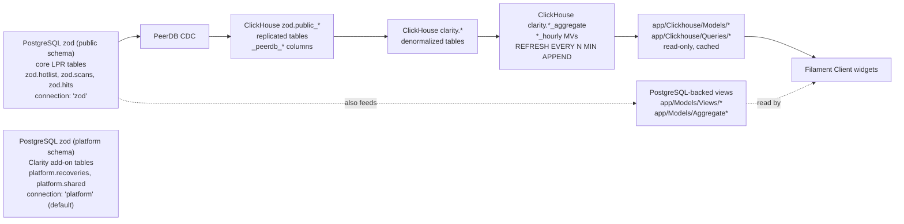

# Data Architecture

> **Read this page first** before writing or editing any query, model, or widget.

Clarity has **two databases**. LLMs (and humans) have repeatedly confused PostgreSQL functions/tables with ClickHouse materialized views/tables. This page is the disambiguator: it tells you which database a symbol lives in, how data flows between them, and the parity traps that look similar but differ.

## Two databases, two roles

- **PostgreSQL** — the **transactional source of truth**. There is one logical PostgreSQL database (`zod`) accessed through **two connections** with different `search_path`s, so tables physically live in **two schemas**:
  - **`zod` connection** (`search_path = public`) → the core LPR tables owned by the upstream `zod` database: `hotlist`, `scans`, `hits`, `kits`, `orgs`, `scans_metadata`. Referenced as `zod.<table>` (e.g. `zod.hotlist`, `zod.scans`). The core domain models (`Scan`, `Hit`, `Hotlist`, `Kit`, `Org`) all declare `protected $connection = 'zod'`.
  - **`platform` connection** (`search_path = platform`) → Clarity's own add-on tables created by local migrations: `recoveries`, `client_org_access`, `shared`, `invites`, `alert_settings`, etc. Referenced as `platform.<table>` (e.g. `platform.recoveries`). The default app connection is `platform`, so models without an explicit `$connection` (e.g. `Recoveries`) land here.
  - **Writes happen in PostgreSQL** (both schemas). All `app/Models/*` Eloquent models (non-`Clickhouse`) are PostgreSQL.
- **ClickHouse** — the **analytical read side** (10–100x faster aggregations). Two CH databases:
  - `clarity` — aggregate/materialized-view tables.
  - `zod` — PeerDB-replicated PostgreSQL tables (the `public` schema source data for the aggregates).
  - **Read-only by default. Never write business data here.**

## Data flow (PostgreSQL → ClickHouse)

**Replication pipeline:**

1. PostgreSQL tables → **PeerDB CDC** → `zod.public_*` ClickHouse tables.
2. PeerDB adds `_peerdb_synced_at` (DateTime64(9)), `_peerdb_is_deleted` (UInt8 soft-delete), `_peerdb_version` (UInt64 dedup version).
3. `zod.public_*` → `clarity.*` denormalized tables (hotlist + json + meta joined; branch_id, repo_date, order_date extracted).
4. `clarity.*` → `clarity.*_aggregate` / `*_hourly` materialized views (`REFRESH EVERY N MINUTE APPEND`, no `POPULATE` — incremental only; queries recent data via `_peerdb_synced_at >= now() - toIntervalHour(2)`).
5. `ReplacingMergeTree` handles late-arriving updates idempotently; `FINAL` forces dedup (use sparingly — impacts performance).

## The disambiguation table (heart of this page)

The same logical concept is a **different physical object** per database. An agent must know which it is touching. Note the PostgreSQL schema split: core LPR tables are in the `public` schema (`zod` connection), Clarity add-on tables are in the `platform` schema (`platform` connection).

| Concept | PostgreSQL (source of truth) | ClickHouse replica (`zod`) | ClickHouse aggregate/view (`clarity`) |
|---|---|---|---|
| Hotlist | `zod.hotlist` (Eloquent `Hotlist`, `$connection = 'zod'`) | `zod.public_hotlist` | `clarity.hotlist` (denormalized), `clarity.hotlist_status_aggregate` |
| Hits | `zod.hits` (Eloquent `Hit`, `$connection = 'zod'`) | `zod.public_hits` | `clarity.client_historical_hits_hourly` |
| Scans | `zod.scans` (Eloquent `Scan`, `$connection = 'zod'`) | — | `scans_cold` (cold storage) |
| Recoveries | `platform.recoveries` (Eloquent `Recoveries`, default `platform` connection) | — | `clarity.recoveries` (table), `clarity.recovery_kit_scan_report` |
| Missed opportunities | `zod.hits`-adjacent (`App\Models\MissedOpportunity extends Hit`) | `zod.public_hits` | `clarity.missed_opportunities` (table, scoped by `hotlist_org_id`) |
| LPR assists | — | — | `clarity.recovery_scans` → view `clarity.lpr_assists` (model `App\Clickhouse\Models\LprAssist`); see [LPR Assist](lpr-assist.md) |

PostgreSQL table → ClickHouse replica/aggregate mappings (see [ClickHouse Integration](clickhouse-integration.md)):

| PostgreSQL Table | ClickHouse Replica | ClickHouse Aggregate |
|---|---|---|
| `zod.hotlist` (`public.hotlist`) | `zod.public_hotlist` | `clarity.hotlist` (via MV) |
| `public.hotlist_json` | `zod.public_hotlist_json` | `clarity.hotlist` (via MV) |
| `public.hotlist_meta` | `zod.public_hotlist_meta` | `clarity.hotlist` (via MV) |
| `zod.hits` (`public.hits`) | `zod.public_hits` | `clarity.hits_cold` / `clarity.hits_hot`; `clarity.hotlist_status_aggregate` |
| `platform.recoveries` (Clarity-owned) | — | `clarity.recoveries` / `clarity.recovery_kit_scan_report` |

> **Schema-name pitfall:** the word "platform" is overloaded — it is the **Clarity add-on schema** (`platform.recoveries`, `platform.shared`, …) *and* the name of the default Laravel connection. The core LPR tables are **not** in the `platform` schema; they are in the `public` schema of the `zod` database, accessed via the `zod` connection. When a doc says "platform schema," verify which tables it means before quoting a path like `platform.hotlist`.

## "Which connection am I on?" decision rule

- `app/Models/*` (plain, no `Clickhouse\` namespace) → **PostgreSQL**. Which schema depends on `$connection`:
  - `$connection = 'zod'` (or table in the `public` schema) → core LPR tables: `zod.hotlist`, `zod.scans`, `zod.hits`, `zod.kits`, `zod.orgs`. Writes allowed, transactional, FK-enforced.
  - default `platform` connection (no explicit `$connection`) → Clarity add-on tables in the `platform` schema: `platform.recoveries`, `platform.shared`, `platform.client_org_access`, `platform.invites`, `platform.alert_settings`. Writes allowed.
- `app/Clickhouse/Models/*` (extend `ClickhouseModel`, `$connection = 'clarity_clickhouse'`) → **ClickHouse**. Read-only analytical.
- `app/Clickhouse/Queries/*` / `app/Clickhouse/Queries/Client/*` (extend `ClickhouseQuery`) → **ClickHouse**, cached 10min, return `[]` on error in production (see [ClickHouse Query Patterns](clickhouse-query-patterns.md)).
- `app/Models/Views/*` and aggregate `app/Models/Aggregate*` → **PostgreSQL-backed DB views** (read-only, refresh automatically — never manipulate directly).

Connections defined in `config/database.php`: `zod` (search_path `public`), `platform` (search_path `platform`, the default), `platform_read`, `graphql`, `pg`, `clarity_clickhouse`, `clarity_clickhouse_write`, `public_clickhouse`.

## Function/feature parity traps

Features that look similar but differ by database — these are the specific confusions that bite LLMs:

- **Dedup:** PostgreSQL uses unique constraints; ClickHouse uses `ReplacingMergeTree` + `FINAL` (async merges, **not guaranteed without `FINAL`**).
- **Month grouping:** `HasMonthGrouping::getMonthSelectSql()` returns the ClickHouse form `toDate(toStartOfMonth(...))` — it is **not** driver-aware. For dual-driver queries, branch on the connection driver yourself (`DATE_TRUNC('month', …)::date` for pgsql). See [ClickHouse Query Patterns](clickhouse-query-patterns.md).
- **`scopeFinal()`:** a no-op on the pgsql driver; only adds `FINAL` on real ClickHouse.
- **Soft deletes:** PostgreSQL uses `deleted_at` (Eloquent soft deletes); ClickHouse uses `_peerdb_is_deleted` (`FilterDeletedRecords` / `FiltersCdcDeletes` global scope, or manual `where('_peerdb_is_deleted', 0)` in raw SQL). **Different column, different filter.**
- **Timezones:** ClickHouse defaults to UTC; scans use PostGIS + `ScanTimezoneScope` for local time on the PostgreSQL side.

## Eventual consistency caveat

ClickHouse lags PostgreSQL by ~1s on CDC; aggregate materialized views refresh every ~10 minutes. ClickHouse results may briefly differ from PostgreSQL — **acceptable for dashboards, never rely on ClickHouse for transactional correctness.** When CH results differ from PG: check replication lag, verify timezone handling, consider `OPTIMIZE TABLE … FINAL` to force merges.

## Dual-driver testing escape hatch

`CLICKHOUSE_DRIVER=pgsql` points the `clarity_clickhouse` connection at a PostgreSQL `clarity_testing` DB so the same query classes run without a real ClickHouse server. **Tests always use PostgreSQL — never point tests at production ClickHouse.** `tests/TestCase.php` wraps **`zod` and `platform`** in `$connectionsToTransact` (not `clarity_clickhouse`); ClickHouse-side test data is handled via the pgsql bridge + factories. See [Testing Conventions](testing-conventions.md).

Three ClickHouse connections in `config/database.php` (full detail in [ClickHouse Integration](clickhouse-integration.md)):

- `clarity_clickhouse` — aggregate tables (`clarity` database), the default `ClickhouseModel` connection.
- `clarity_clickhouse_write` — write path (separate credentials) for seeders/jobs.
- `public_clickhouse` — PeerDB-replicated PostgreSQL tables (`zod` database).

Feature flag: `config('database.use_clickhouse')` is a convenience flag, `true` when `CLICKHOUSE_HOST` is set.

## Key Clarity ClickHouse tables

| Table | Engine | Purpose |
|-------|--------|---------|
| `clarity.hotlist` | ReplacingMergeTree | Denormalized hotlist (branch_id, order_date, repo_date, close_date) |
| `clarity.hotlist_status_aggregate` | AggregatingMergeTree | Status changes by hour (`uniqMerge(unique_hotlists)`) |
| `clarity.client_days_to_repo` | ReplacingMergeTree | Days-to-repo by recovery type |
| `clarity.client_historical_hits_hourly` | AggregatingMergeTree | Historical hit counts (`uniqExactMerge`) |
| `clarity.hits_cold` / `clarity.hits_hot` | ReplacingMergeTree | Denormalized hits (hot TTL 90d) |
| `clarity.scans_cold` / `clarity.scans_hot` | ReplacingMergeTree | Denormalized scans (hot TTL 90d); kit↔`camera_name` aggregate |
| `clarity.missed_opportunities` | ReplacingMergeTree | Missed-opportunity rows (scoped by `hotlist_org_id`) |
| `clarity.recoveries` / `clarity.recovery_kit_scan_report` | ReplacingMergeTree | Recovery + kit scan-count join |
| `clarity.kit_scan_paths` / `clarity.kit_trips` | ReplacingMergeTree | Kit path/trip aggregations (TTL 90d) |

Full table list + engines in [ClickHouse Integration](clickhouse-integration.md).

## Where it lives in code

- Connection config: `config/database.php` (connections + `use_clickhouse` flag)
- Base CH model: `app/Clickhouse/Models/ClickhouseModel.php` (`$connection = 'clarity_clickhouse'`, `scopeFinal()`)
- CH scopes: `app/Clickhouse/Scopes/FilterDeletedRecords.php`; CDC trait `app/Clickhouse/Concerns/FiltersCdcDeletes.php`
- CH queries base: `app/Clickhouse/Queries/ClickhouseQuery.php`
- Schema dumps: `database/schema/clickhouse-schema.sql`, `database/schema/clickhouse-testing-postgres.sql`
- **Core `zod` schema ownership:** the `zod.public` tables (`scans`, `hits`, `hotlist`, `kits`, `orgs`, `scans_metadata`) and the hit-creation triggers/functions (`find_hits()`, `find_historicals()`) are owned by the `insight-lpr/laravel-zod-migrations` composer package (https://github.com/insight-lpr/laravel-zod-migrations), not by this repo's migrations. This repo's migrations only create the Clarity add-on tables in the `platform` schema. See [Repositories](repositories.md) and [Drift Watch](drift-watch.md).

## See also

- [ClickHouse Integration](clickhouse-integration.md) — connections, CDC, tables, the pgsql test bridge
- [ClickHouse Query Patterns](clickhouse-query-patterns.md) — `FINAL`, CDC filter, driver-aware SQL, hot/cold, caching
- [Client Analytics](client-analytics.md) — metrics built on the `clarity` aggregates
- [Missed Opportunity](missed-opportunity.md) — `clarity.missed_opportunities` and `hotlist_org_id`
- [Testing Conventions](testing-conventions.md) — `zod_testing` + the pgsql bridge
- [Scan](scan.md) — `zod.scans` vs `scans_cold`
- [Hit](hit.md) — `zod.hits` vs `hits_cold` / `hotlist_status_aggregate`
- [Hotlist](hotlist.md) — `zod.hotlist` vs `zod.public_hotlist` / `clarity.hotlist` / `clarity.hotlist_status_aggregate`
- [Recovery](recovery.md) — `platform.recoveries` vs `clarity.recoveries` / `clarity.recovery_kit_scan_report`
